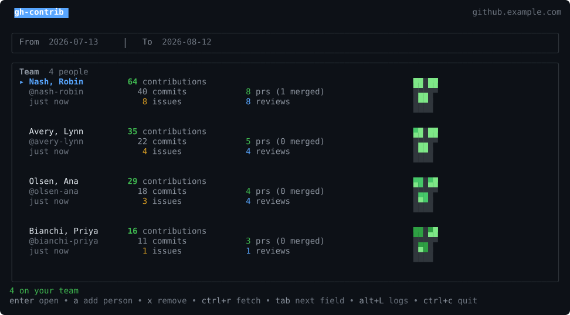
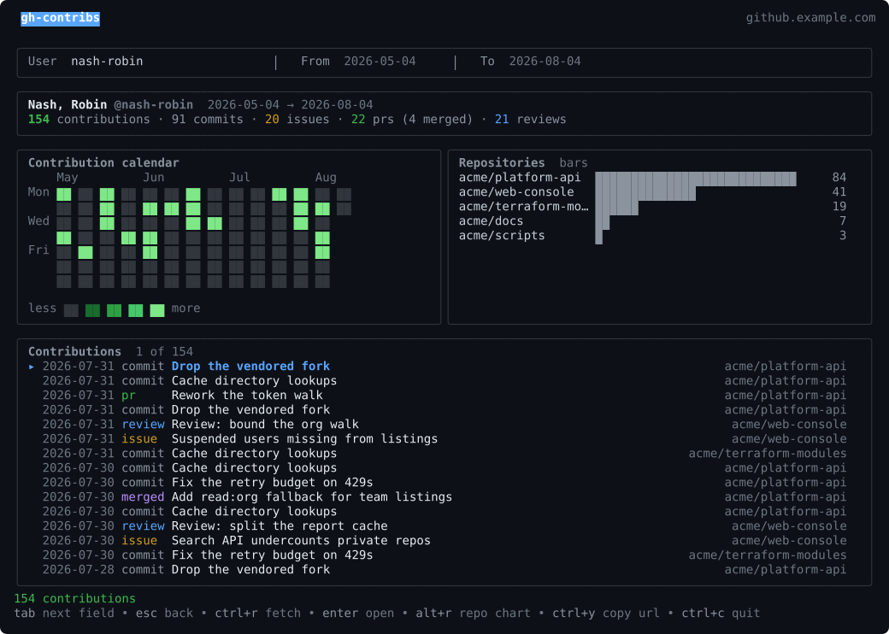
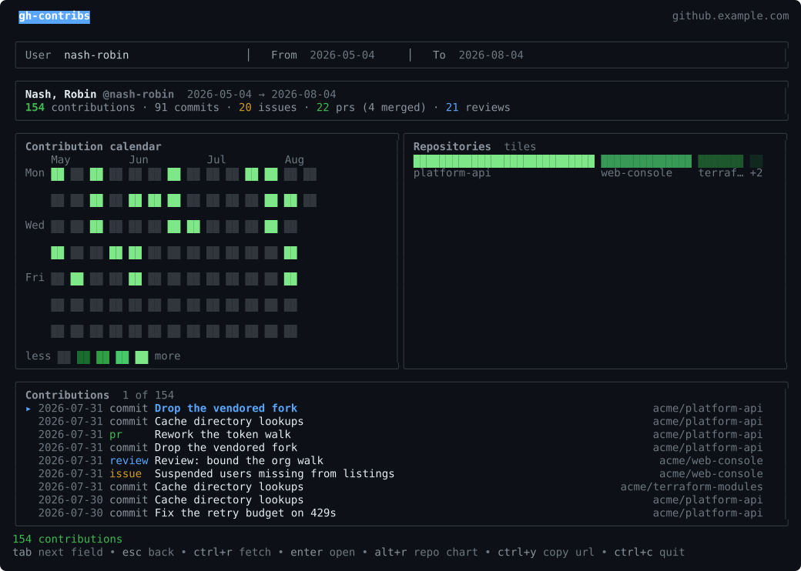

# gh-contribs

A terminal dashboard for GitHub contribution activity. It opens on a team
summary — everyone you follow, ranked by how much they have been doing — and
drills into one person's history: their totals, a contribution calendar, which
repositories the work went to, and the individual commits, pull requests, issues
and reviews behind the numbers.

It works against github.com and against GitHub Enterprise Server.



Pressing enter on a row opens that person's history — their totals, a
contribution calendar, where the work went, and the contributions themselves:



`alt+r` switches the repository breakdown from ranked bars to a single row
divided by share:



## Why not the contributions API

GitHub's `contributionsCollection` ignores activity in private and internal
repositories, and on Enterprise Server it does not report the omission — the
count simply comes back small. One user with 237 contributions on their profile
reported 3 through that endpoint, because every repository they work in is
private.

This tool assembles history from the search APIs instead, which honour whatever
the token can actually read. A `repo`-scoped token sees the real history.

Search has a blind spot of its own: `/search/commits` indexes a repository's
default branch and nothing else, so work pushed to a feature branch and not yet
merged is missing entirely — one user here showed **0 commits** for a month in
which they had made **5**, all on branches. So the commits are gathered twice:
from commit search, and by walking the branches of repositories pushed to
inside the window. A commit found only on a branch is counted like any other
and shown as `owner/repo@branch`, so unmerged work is visible as unmerged.

## Requirements

- Go 1.25 or newer to build
- A GitHub token with the `repo` scope, and `read:org` if you want
  organization-wide autocomplete
- Optional: the [`gh` CLI](https://cli.github.com), which the app will borrow a
  token and a hostname from
- Against a private GitHub Enterprise Server: the internal VPN, which the
  host is only reachable from

## Install

```sh
go build -o gh-contribs ./cmd/github-contrib-tui
```

Or run it straight from the source tree:

```sh
go run ./cmd/github-contrib-tui
```

## Authentication

Tokens are tried in order, and the first that authenticates wins:

1. `GITHUB_TOKEN`
2. `GH_TOKEN`
3. `gh auth token`

If a request comes back unauthorized, the next candidate is tried before giving
up, so a stale environment variable does not block a working `gh` login.

The host is resolved from `GITHUB_HOSTNAME`, then `GH_HOST`, then `gh auth
status`, falling back to github.com.

### GitHub Enterprise Server

`github.example.com` is only reachable from the internal network, so you
must be on the VPN for anything to work — the app, `gh`, and `git` alike. Off
the VPN the host does not resolve or the connection times out, and the failure
looks like a dead network rather than a bad token: `dial tcp: lookup
github.example.com: no such host`, or a fetch that hangs and then errors.
Connect first, then re-check the token.

### When authentication does not work

Start by asking what token you have and what it is allowed to do:

```sh
gh auth status              # which host, which account, which scopes
```

That reads the `gh` login only. To ask the same of whatever token the app would
actually pick up, send it at the API and read the scopes off the response
headers — GitHub reports them on every authenticated REST request:

```sh
curl -sI -H "Authorization: Bearer $GITHUB_TOKEN" \
  https://github.example.com/api/v3/user | grep -i x-oauth-scopes
```

Use `https://api.github.com/user` for github.com. `X-OAuth-Scopes` lists what
the token carries; a `200` with an empty list means the token authenticates but
grants nothing — expect empty results rather than errors. Fine-grained personal
access tokens and GitHub App tokens have no scopes at all and always report an
empty header; their permissions are only visible on the token's own settings
page.

| Symptom | Likely cause |
| --- | --- |
| `... failed for all token sources; refresh credentials` | every candidate token is expired or revoked — `gh auth login`, or replace `GITHUB_TOKEN` |
| Authenticates, but everyone shows 0 contributions | the token is missing `repo`, so private and internal repositories are invisible |
| Adding someone autocompletes nothing | the token is missing `read:org` |
| A stale `GITHUB_TOKEN` seems to be winning | it is tried first; `unset GITHUB_TOKEN GH_TOKEN` to fall through to `gh` |
| Requests hang or the host will not resolve | not on the VPN (Enterprise Server only) |

`alt+L` opens the log pane, which names the token source it tried and a
fingerprint of the token itself — first and last four characters and its length,
never the whole thing — so you can tell which credential a failure belongs to.

## Using it

The app opens on the **dashboard**: one row per person on your team, showing
their totals and a minified contribution calendar, ranked by contributions.
Pressing enter on a row opens the **details** screen for that person.

| Key | Where | What |
| --- | --- | --- |
| `enter` | dashboard | open the selected person's details |
| `a` | dashboard | add someone to the team |
| `x` | dashboard | remove the selected person |
| `esc` | details | back to the dashboard |
| `alt+r` | details | switch the repository chart between bars and tiles |
| `ctrl+r` | both | refetch — everyone on the dashboard, this person on details |
| `/` | both | filter the list |
| `enter` | details | open the selected contribution in a browser |
| `ctrl+y` | details | copy the selected contribution's URL |
| `tab` | both | move between the fields and the list |
| `ctrl+u` | both | reload the user directory from GitHub |
| `alt+L` | both | show the log pane |
| `ctrl+c` | both | quit |

Adding someone autocompletes against every member of your organizations,
matching on login or display name. Accounts that only appear through team
membership — suspended or departed people — are listed and marked, because a
departed teammate is often exactly who you want to look up. See
[docs/design/user-suggestions.md](docs/design/user-suggestions.md).

### Dates

The dashboard summarizes the trailing 30 days, details the trailing 3 months.
The `From` and `To` placeholders always spell out the window an empty field
resolves to.

Dates may name a day, a month, or a year, with either separator. A partial date
names a period, and the two ends of the window take opposite ends of it:

| Typed | Resolves to |
| --- | --- |
| `2026-05-04` | that day |
| `2026-05` in `From` | 2026-05-01 |
| `2026-05` in `To` | 2026-05-31 |
| `2026/05` | the same, slashes and dashes are interchangeable |
| `2025` in `To` | 2025-12-31 |

## Where it keeps things

Everything is scoped by host, so github.com and an Enterprise deployment never
share a team or a cached report.

| What | Where | Lifetime |
| --- | --- | --- |
| Your team | `<config>/gh-contribs/team-<host>.json` | until you change it |
| Contribution reports | `<cache>/gh-contribs/reports-<host>.json` | 1 hour |
| User directory | `<cache>/gh-contribs/directory-<host>.json` | 24 hours |

`<config>` and `<cache>` are your platform's own — `~/.config` and `~/.cache` on
Linux, `~/Library/Application Support` and `~/Library/Caches` on macOS.

The team file is written indented and is meant to be edited by hand. The two
caches are disposable: delete them and the next launch refetches.

Reports paint from cache first and refresh behind what is already on screen, so
a launch shows numbers immediately rather than a screen of spinners. `ctrl+r`
goes past the cache whatever its age.

## Environment

| Variable | Effect |
| --- | --- |
| `GITHUB_TOKEN`, `GH_TOKEN` | API tokens, tried before the `gh` CLI |
| `GITHUB_HOSTNAME`, `GH_HOST` | which GitHub to talk to |
| `GH_USER` | open straight to this person's details, skipping the dashboard |

## Layout of the source

```
cmd/github-contrib-tui   the binary: wires a client, the stores, and the UI
cmd/ansi2svg             turns a captured terminal frame into an SVG
cmd/screenshots          renders the README's frames and converts them
internal/contrib         the domain — reports, events, calendars, date ranges.
                         No GitHub client, no terminal.
internal/ghapi           GitHub GraphQL and REST, and the credential fallback
internal/ui              the bubbletea model, its two screens, and lipgloss
internal/auth            token discovery
internal/config          which GitHub deployment, and its endpoints
internal/teamconfig      the team roster, in the config directory
internal/reportcache     contribution reports, in the cache directory
internal/directorycache  the user directory, in the cache directory
internal/platform        opening a browser and the clipboard, per OS
internal/logging         the logger the pane reads from
internal/ansisvg         the ANSI-to-SVG conversion behind both commands
```

The domain package knows nothing about GitHub or the terminal, and the UI
reaches GitHub only through an interface it defines itself, so both are testable
without a network.

## Development

```sh
go test ./...            # the suite
go test ./... -race      # with the race detector
go vet ./... && gofmt -l internal cmd
```

Tests are written before the code they cover, and cover the fallbacks as well as
the happy path — narrow terminals, missing scopes, corrupt caches, and slow
answers arriving after the user has moved on.

### The screenshots

They are the real screens rather than mockups, and they regenerate with one
command:

```sh
go run ./cmd/screenshots               # writes docs/images/*.svg
go run ./cmd/screenshots -ansi /tmp/f  # keeps the captured frames too
```

That command owns the sample team and their histories, renders each frame
through the UI itself, and converts it. Two runs produce identical files.

The conversion is ours rather than a library's, which is worth explaining. These
frames are an unusual input: a dense grid of box-drawing and block characters
where a general converter has to typeset what is really geometry, and then the
output only lines up if the reader's font agrees with the grid. `cmd/ansi2svg`
draws them instead — blocks are rectangles, borders are stroked paths — so
nothing depends on a font being installed or embedded, and gaps of two or more
spaces become position rather than text, since a renderer collapses those and
the calendar's month labels would bunch up against its left edge.

[wader/ansisvg](https://github.com/wader/ansisvg) was measured against it on
these same frames. Its `--grid` mode drew the panel borders as broken dashes
unless a font was embedded, which took one image from 113 KB to 3.3 MB, and
positioning every character on the grid left visible gaps inside words. It is a
good tool for ordinary coloured output; a full-screen TUI frame is not that.

`cmd/ansi2svg` remains for converting a frame captured some other way:

```sh
some-program-that-prints-a-frame | go run ./cmd/ansi2svg -o out.svg
```

## Also in this repo

`scripts/github-contrib` is the shell script this started as: one `gh api
graphql` call against `contributionsCollection`. It is kept for reference, and
is subject to the under-counting described above.
